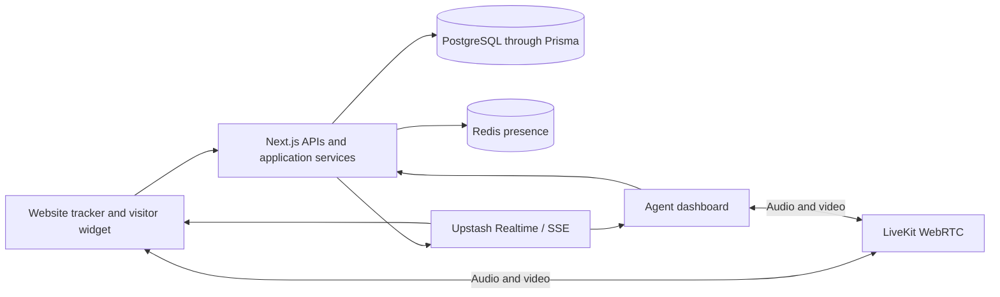

# Supernizo Autocall

**Real-time website visitor engagement through live presence, chat, and browser calls.**

Supernizo Autocall gives a team context about visitors currently browsing its websites and a way to start a conversation. Agents can view live sessions, exchange messages, and invite visitors to voice or video calls. Visitors choose whether to accept and grant microphone or camera access.

This repository is a project showcase covering the product workflow and engineering architecture. Application source code and deployment configuration are maintained separately.

## The problem

A page view can show interest, but it does not give a visitor a conversation. Teams need to understand what is happening on a website and respond while the visitor is still there.

Autocall brings that context and the conversation into one workspace.

## What it does

| Capability             | Experience                                                                                               |
| ---------------------- | -------------------------------------------------------------------------------------------------------- |
| Live visitor dashboard | View online visitors, their current page, and session context.                                           |
| Website tracking       | Capture page activity, engagement, referrers, and campaign attributes through an embeddable browser SDK. |
| Live chat              | Exchange messages between an agent dashboard and a website widget, with durable conversation history.    |
| Voice and video calls  | Send browser call invitations, with ringing, acceptance, decline, cancellation, and end states.          |
| Visitor voice requests | Let visitors request an audio call from the website widget.                                              |
| Incoming-call alerts   | Display call notifications with separate dashboard and visitor ringtones.                                |
| Contact follow-up      | Let visitors optionally share email or WhatsApp details with consent, and track reply status.            |
| Multiple sites         | Configure individual website keys, allowed origins, and widget settings.                                 |
| Staff access           | Connect staff sign-in and eligibility to the surrounding Supernizo platform.                             |

## A typical interaction

1. A visitor opens a website with the tracker installed.
2. The agent dashboard receives live presence and session updates.
3. An agent opens the visitor's conversation or sends a call invitation.
4. The visitor accepts or declines the invitation. Accepted calls request the required browser media permissions.
5. Messages and call metadata remain available in the workspace after the interaction.

## Architecture at a glance

The application coordinates authorization, call state, and media access. LiveKit carries the audio and video streams.

## Technology

| Area              | Technology                                                     |
| ----------------- | -------------------------------------------------------------- |
| Application       | Next.js App Router, React, TypeScript                          |
| HTTP boundary     | Route Handlers and Zod validation                              |
| Durable records   | PostgreSQL and Prisma                                          |
| Presence          | Redis                                                          |
| Realtime delivery | Upstash Realtime and Server-Sent Events                        |
| Audio and video   | LiveKit and WebRTC                                             |
| Workspace         | pnpm workspaces and a shared contracts package                 |
| Verification      | Vitest, Playwright, architecture checks, and deployment checks |
| Deployment design | Docker, Nginx, and PostgreSQL backups                          |

## Engineering decisions

- Separate durable history from short-lived presence so an online status does not become a permanent database record.
- Keep business logic in application services, with provider and repository interfaces around external dependencies.
- Share validated contracts between the application and tracker SDK.
- Keep browser media transport separate from Next.js request handling.
- Require visitor acceptance and browser permissions before joining an incoming media session.
- Validate site keys and allowed origins, and rate-limit public tracker requests.

## Explore the project

- [Architecture and service boundaries](docs/architecture.md)
- [Demo walkthrough](docs/demo-walkthrough.md)
- [LinkedIn post draft](LINKEDIN_POST.md)
